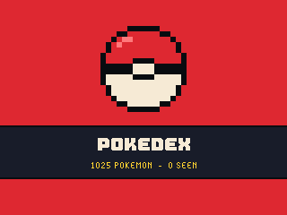
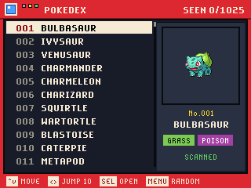
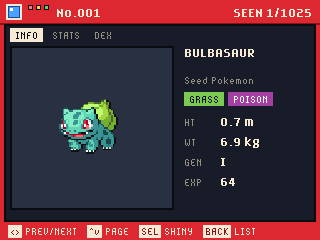
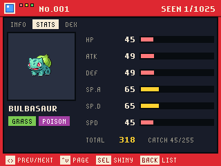
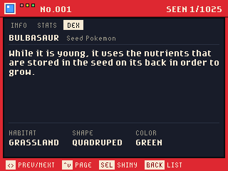
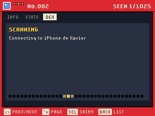

# Pokedex for the GitHub Universe 2026 badge

An 8-bit Pokedex app for the GitHub Universe 2026 badge. It lists all 1025
Pokemon, scans each entry live from [PokeAPI](https://pokeapi.co) over Wi-Fi,
and keeps what you have scanned on the badge.

| Splash | List | Info |
| --- | --- | --- |
|  |  |  |

| Stats | Dex text | Scanning |
| --- | --- | --- |
|  |  |  |

## Install

1. Put the badge in USB Disk Mode (open the Mass Storage app, or double-tap
   RESET) so the `BADGER` volume appears.
2. Copy the `apps/pokedex` folder into `BADGER/apps/` (so you end up with
   `BADGER/apps/pokedex/__init__.py`).
3. If your badge still runs the stock event menu, its tiles ignore `icon.png`.
   The [hyb26 skill](https://github.com/badger/home/tree/main/.github/skills/hyb26-skill)
   ships `patch_menu_icons.py`, which adds that support (with a backup).
   Without it the app still works, it just shows the default tile icon.
4. Eject the volume. The badge restarts into the menu with a Pokedex tile.

Scanning needs Wi-Fi: set `WIFI_SSID` and `WIFI_PASSWORD` in the badge's
`secrets.py` (the Settings app does this). The list, stats and types work
without a connection; dex text and sprites are fetched when you open an entry.

## Controls

| Button | List | Entry |
| --- | --- | --- |
| Up / Down | Move (hold to scroll fast) | Switch page: Info, Stats, Dex |
| Left / Right | Jump ten entries | Previous / next Pokemon |
| Select | Open the entry | Toggle the shiny sprite (retries a failed scan) |
| Menu | Random Pokemon | Random Pokemon |
| Back | - | Close the entry |

## How it works

- `apps/pokedex/__init__.py` is the app: screens, input, the cache and the
  scan state machine. Every screen is drawn with the firmware's bitmap fonts
  and nearest-neighbour scaled sprites for a crisp 8-bit look.
- `apps/pokedex/pokeapi.py` reads the bundled core table and distils a PokeAPI
  species record. The record holds every language, so it is scanned as bytes.
- `apps/pokedex/assets/core.bin` holds stats, types, height, weight, base
  experience and generation for every Pokemon (15 bytes each), built from
  PokeAPI's CSV tables by `tools/build_data.py`. PokeAPI's REST `pokemon/{id}`
  records run 250-675KB because of move lists, far more than the badge's 1MB
  writable partition can stream, so the app fetches only the 16-50KB species
  record and the sprite for each entry.
- Scanned entries are cached under `/state/pokedex` (the newest 80 are kept).

## Tools

- `tools/build_data.py` regenerates `names.txt` and `core.bin` from PokeAPI.
- `tools/make_icon.py out.png` draws the pixel Pokeball icon.
- `tools/badge_harness.py` drives the app's frame loop on a real badge over
  `mpremote run`, simulating button presses and saving run-length encoded
  screenshots to `/state/shots`; `tools/rle2png.py` converts them.

Pokemon data and sprites come from [PokeAPI](https://pokeapi.co) and the
[PokeAPI sprites](https://github.com/PokeAPI/sprites) repository. Pokemon is a
trademark of Nintendo, Creatures Inc. and Game Freak; this is a fan project.
